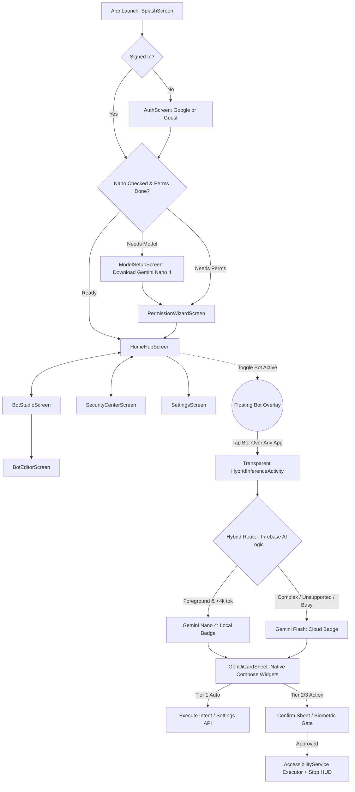

# Mote — Complete UI Flows & User Journeys Pack

This pack defines every screen, interaction state, navigation transition, and edge-case recovery path for **Mote**, a native Kotlin 2.x + Jetpack Compose Android app built for [#BuildHybridAI 2026](https://firebasehybridaihackathon.devpost.com/rules).

## Files in This Pack

1. `00-README-navigation-map.md` — Master screen inventory, Compose route map, and brand design tokens.
2. `01-splash-onboarding-and-permissions.md` — Splash screen, Firebase Auth, Gemini Nano 4 download/warm-up, and progressive Android permission wizard.
3. `02-home-hub-and-bot-studio.md` — Main app hub, hybrid status dashboard, and customizable Bot Studio (synced via Firestore).
4. `03-floating-bot-overlay-and-generative-ui.md` — Persistent onscreen bot states, foreground scrim handoff for Gemini Nano 4, and the 6-widget Generative UI Compose renderer.
5. `04-phone-control-confirmation-and-safety.md` — 3-tier action confirmation UX, AccessibilityService execution HUD, PII redaction, and Security Center.
6. `05-core-user-journeys-and-edge-cases.md` — Four end-to-end user journeys (including the 3-minute Devpost demo script) plus AICore quota, offline, and security edge cases.

---

## Brand & UI Design Tokens

| Token | Hex / Value | Usage |
|---|---|---|
| `MoteNavy` | `#0B0D1D` | Primary brand mark, splash background, dark-mode surfaces, primary buttons |
| `CanvasWhite` | `#FFFFFF` | Light-mode primary background |
| `SurfaceCool` | `#F4F6F8` | Secondary containers, sheets, inactive chips |
| `LocalNanoEmerald` | `#059669` / `#065F46` (text) | **Local Nano 4** hybrid badge, offline-ready indicator, safe action confirmation |
| `CloudFlashCobalt` | `#1D4ED8` / `#1E3A8A` (text) | **Cloud Flash** fallback badge, cloud sync status, active sliders/toggles |
| `DangerCrimson` | `#DC2626` | Tier-3 destructive action warning, Stop kill-switch, revoked permission alert |
| `CornerRadius` | `20.dp` (cards) / `999.dp` (pills & bots) | Consistent squircle/pill geometry matching the Mote icon |

---

## Complete Screen Inventory & Compose Routes

| Route | Screen Name | Entry Trigger | Primary Firebase / Android API |
|---|---|---|---|
| `splash` | Splash & Warm-Up | App launch | `Firebase.initialize()`, App Check, `FirebaseAIOnDevice.checkStatus()` |
| `auth` | Sign-In / Guest | First launch | Firebase Authentication (Google / Anonymous) |
| `model_setup` | On-Device Model Setup | Nano not yet downloaded | `FirebaseAIOnDevice.download()`, `warmUp()` |
| `permissions` | Permission Wizard | Missing overlay or accessibility | `Settings.ACTION_MANAGE_OVERLAY_PERMISSION`, `ACTION_ACCESSIBILITY_SETTINGS` |
| `home` | Home Hub | Main app entry | Firestore bot listeners, Remote Config, Hybrid Router status |
| `bot_studio` | Bot Studio List | Bottom nav / FAB | Cloud Firestore (`users/{uid}/bots`) |
| `bot_editor/{botId}` | Bot Editor | Tap bot or "+ New Bot" | Compose Canvas avatar customizer + Firestore write |
| `security` | Privacy & Security Center | Bottom nav | Local blocklist DataStore, App Check status, Action Audit Log |
| `settings` | App & Hybrid Settings | Top-bar gear icon | Remote Config flags, default `InferenceMode`, spend cap info |
| *(Service)* | Floating Bot Overlay | Persistent over any app | `WindowManager` (`TYPE_APPLICATION_OVERLAY`) + `ComposeView` |
| *(Transparent Activity)* | Hybrid Inference & GenUI Sheet | Tap floating bot | Transparent foreground `ComponentActivity` (enables local Gemini Nano 4) |

---

## End-to-End Navigation Graph

